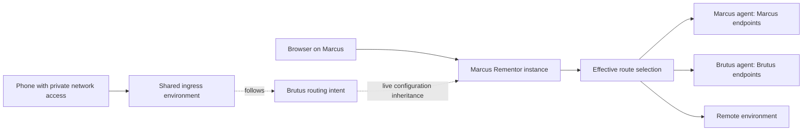

# Personal fleet routing and inherited environments

Status: the routing model, durable plan API, CLI inspector, and authenticated peer pairing are implemented.
Authenticated node forwarding is integrated with the local nginx gateway. Live
inheritance and peer endpoint health are implemented in the daemon backend.
Typed RPC and UI/CLI/MCP inheritance and public-access controls are implemented.
The authenticated node Serve data plane and runtime origin contract are implemented.
GISS build integration and physical cross-host transport acceptance are implemented.
Shared ingress ownership/recovery and its pinned forwarding and UI/CLI/MCP controls
are implemented and tested with isolated replicas and the physical Marcus/Brutus
gateways. Stable gateway identity and the real-phone authenticated device check
remain unfinished. This document supersedes
the earlier single-host/same-origin proposal.

Baseline: local `main` at `1395f9f`, including the isolated routing sessions,
React/shadcn dashboard, and nginx reload improvements, combined with the GitHub
`origin/main` MCP protocol support at `a256291`. The local baseline had not been
pushed upstream when this work began; neither side should replace the other.

## Whole-computer following correction

The current UI follows an entire computer configuration, excluding source
sessions. Followed toggles and route edits write to the source with a version
check, including transitive sources. They never create receiver route overrides.
Extra local environments remain local and sessions retain pinned baselines.
The per-environment override descriptions below document the earlier compatible
API; they do not describe the current whole-computer UI. Aggregate state and
workspace projections commit atomically with a route-operation journal.

## Product contract

Rementor serves one person across their fleet of computers and client devices.
An instance can use its own environment or **follow another instance's routing
configuration live** across its complete set of environments. Edits to a
followed route change the source configuration. Extra local environments and
pinned routing sessions remain independent. Phones and computers without
Rementor consume a reachable shared ingress; they need no nginx installation.

For example, Brutus follows Marcus’s environments. Toggling orders on Brutus
edits Marcus’s configuration; both then use the same selection. Brutus can also
keep an extra local environment or a separate pinned feature session.
When Brutus's selected process fails, the request fails visibly. Inheriting
Brutus's loopback endpoint never turns it into Marcus's loopback endpoint.

The domain supports independent public origins and paths for frontend, services,
login, and WebSockets. It does not require a frontend/API naming convention or
collapse all applications under one hostname. A frontend development build must
work across devices by referring to the configured public routing topology,
rather than baking in the machine hosting an upstream.

Tailscale support is required, but configuration inheritance and route selection
must also work without Tailscale. Tailscale Services is a candidate ingress
adapter, not a core dependency or a settled infrastructure choice. A custom
private transport can be another adapter if its access, identity, DNS, and TLS
behavior are verified.

Private transports connect stable gateway/agent endpoints. Switching an
application from Brutus to a remote environment changes Rementor's route
selection; it should not require editing network tunnel routes on every client.
Phone access still requires the chosen private network client or another
authenticated access path to that gateway.

These requirements come from the prior design thread
`941eee8e-8b24-469c-9a8f-588ffae0f0dc` and the continuation in
`80645e42-698e-4c50-b07f-402667ad5c02`. Named per-client profiles and transparent
shared-ingress device detection were recommendations in the old discussion;
they are not required by the clarified instance-inheritance model.

## Architecture



Separate configuration inheritance from request forwarding:

- Inheritance reads another instance's **routing intent**, not its rendered
  nginx config. Structured intent preserves endpoint ownership and route identity.
- Each instance owns its overrides. Nearest override wins, then its parent,
  then the route's baseline target. Removing an override resumes inheritance.
- A node-owned endpoint is forwarded through that node's authenticated agent.
  A URL containing `127.0.0.1` is dialed only in the owner's network namespace.
- Remote endpoints are reached directly under explicit upstream policy.
- A route alias follows another route's selection in the serving instance's
  effective environment. It does not cause an HTTP redirect or rematch the URL.
- Shared ingress follows a nominated environment. An ingress replica serving
  the same public access point must use the same effective environment; network
  load balancing must not select different development configurations at random.

This replaces a single replicated mutable routing table with independently
owned instance configuration. It does not require consensus to edit Marcus's or
Brutus's own overrides. Changing a **shared ingress environment selector** is
different: its owner must serialize/version changes so two gateways do not
silently disagree. A permanent fleet-wide coordinator is not needed for the
first inheritance slice.

## State and offline behavior

Existing routing sessions already persist a pinned remote baseline, local
registrations, revision metadata, and explicit preview/apply refresh. Preserve
that behavior. Fleet inheritance is a separate live relationship between
instances; it must not make feature sessions silently follow parent changes.
Extend the existing session/selector and transaction machinery where applicable
rather than adding a second incompatible workspace-cloning system. The chosen
inheritance scope must identify its environment/session explicitly.

See the [implemented session design](worktree-routing-sessions.md) and
[toggle latency work](toggle-latency.md). Fleet updates must preserve session
isolation, concurrency/version checks, routing proofs, and reload optimizations.

Use explicit, versioned records for nodes, origins, routes, targets, instance
overrides, inheritance pointers, and the shared ingress selector. Existing
workspace/environment identifiers and canonical application/service identities
remain durable references.

For live inheritance, each instance publishes a versioned snapshot of its own
intent, including the parent reference. Subscribers fetch and validate a
complete candidate, resolve the transitive inheritance graph, apply a detached
proxy projection, and publish only after successful persistence/application.
Reject missing references, environment-inheritance cycles, and effective
route-alias cycles. Polling a version endpoint is sufficient initially; streaming
can later reduce propagation latency without changing resolution semantics.

Proposed offline policy, still to validate in the live-sync milestone:

- Cache the last validated inherited snapshot. Report its source/version and
  stale status when its owner cannot be reached. Do not silently treat stale
  configuration as a current synchronization result.
- Local overrides remain editable without the parent. An inherited node target
  still fails if its endpoint/owner cannot be reached.
- A cached choice of a reachable remote endpoint may continue serving while the
  configuration owner is offline. Display the stale inheritance state separately
  from endpoint health. Failure of the configuration source and failure of the
  selected target are distinct events.
- Shared-selector changes require its current owner, or an explicit ownership
  transfer. Do not accept conflicting offline mutations to that selector.

Do not add silent failover between application instances. A user intentionally
testing Brutus must see Brutus's failure. A future explicit fallback policy must
report both the intended target and the actual target and remain opt-in.

## Public URLs and private access

The portable build consumes stable public routes; it never refers to an
upstream node's loopback URL. A build can use the current origin for genuinely
same-origin APIs, or an ingress-supplied runtime origin map for applications with
separate frontend/API/login/event origins. `window.location.origin` alone cannot
describe every topology.

Local `*.localhost` access continues to work with a local Rementor gateway that
inherits a reachable peer's intent. This does not require a Tailscale client when
the peer is accessible over another explicitly configured private transport.
Inheritance copies no DNS zone or certificate and cannot make an unreachable
peer endpoint reachable.

The same logical URL on multiple computers with different effective environments
needs an explicit **ingress-selection** design. Before promising that behavior
on portable HTTPS names, choose and test one of:

1. Local gateway interception of the canonical hostname, with supported DNS and
   trusted certificates on computers running Rementor. Phones use shared ingress.
2. Authenticated client-device selection at shared ingress, after proving exact
   node identity survives the chosen proxy path. The selected policy references
   that device's Rementor instance and its inherited environment.

Distinct instance entry URLs are useful for diagnostics, but changing bookmarks
and browser origins is not a substitute for the requested stable URL behavior.
Preserving exact origins offline also needs DNS/TLS handling. A local alias is
not evidence that the portable frontend build works offline unchanged. This
question belongs to the access/build milestone, rather than assuming that
configuration inheritance solves name resolution.

Tailscale can supply private node connectivity. Services adds stable service
names, TailVIPs, and Serve-managed HTTPS but has setup/tagging requirements and
does not supply arbitrary custom-domain wildcard hosting. Serve HTTP user headers
do not identify a specific device; Marcus and Brutus may share that user identity.
See the [verified research and provider acceptance tests](../research/tailscale-routing.md).

Keep the existing unauthenticated Connect control plane bound to loopback. Any
fleet synchronization or forwarding listener is a separate authenticated
interface. Enrollment must authorize peers independently of their ability to
reach a TCP port; every LAN/tunnel adapter must define how it establishes that
trust. A shared data-plane gateway must not accidentally expose management RPC.

## First runnable slice: implemented

`internal/routing` compiles an immutable, provider-independent intent snapshot
and resolves public URLs for a serving instance. The CLI reads an experimental
JSON file; it does not mutate the live workspace model. The plan API uses a typed protobuf/Connect contract and persists validated plans
in SQLite. Configuration now focuses on actual peer enrollment; the planning
controls were removed from that page.

Implemented behavior:

- Explicit public origins, including scheme and port; exact and segment-bounded
  prefix path precedence, with HTTP(S)/WebSocket origin correspondence.
- Remote, node-owned, and logical-route target types.
- Transitive environment inheritance and per-instance route overrides.
- Shared ingress environment selection and inheritance provenance in output.
- Reference validation, duplicate-matcher rejection, and cycle rejection.
- Simulated endpoint/owner unavailability with a visible error and nonzero exit;
  no automatic fallback and no claim of live target health.
- Detached snapshots: changing caller-owned configuration cannot mutate an
  already compiled projection. Recompiling a parent change updates inherited
  selections while preserving child overrides.

Try the [fleet example](../../examples/fleet/README.md):

```bash
go run ./cmd/rementorctl --json topology resolve \
  --file examples/fleet/topology.json --instance marcus-dev \
  --url https://services.rementor.example.test/orders/42
```

The JSON schema is versioned as an **experiment**, not a replacement for existing
workspace export/import or active routing. URL paths are canonicalized; ambiguous
encoded paths are rejected in the inspector. Route rewriting, upstream header
policy, cookies/CORS, TLS, actual probes, replication, and listeners are outside
this slice. Do not use it as a production forwarding engine yet.

## Delivery milestones

| Milestone | Deliverable | Acceptance scenario |
| --- | --- | --- |
| 0 — intent resolution | Implemented file-based resolver, example, tests | Marcus follows Brutus's orders choice, keeps its billing override, and exposes target failure |
| 1 — durable fleet intent | Implemented SQLite records, typed protobuf/Connect plan API, and dedicated CLI/MCP show/review/save controls with signed review/version checks | Restart preserves inheritance and overrides; invalid references/cycles fail before persistence; legacy workspace behavior is unchanged |
| 2 — live inheritance | Implemented pinned enrollment, authenticated snapshots, persisted follow/cache/overrides/reset, conditional polling, source status, and journaled application; typed local RPC, UI/CLI/MCP controls implemented; physical-host HTTP, propagation, restart/offline/reset acceptance passed | Brutus changes orders; Marcus follows automatically within a documented bound; a source outage is shown separately from endpoint failure |
| 3 — owner-aware forwarding | Implemented authenticated declared-binding HTTP/stream/WebSocket transport, nginx integration, durable endpoint references, stream revocation, and owner endpoint health probes; typed owner metadata and source/target status controls implemented; physical-host HTTP/WebSocket and revocation acceptance passed over Tailscale and LAN | Marcus reaches Brutus's loopback endpoint; stop that endpoint and receive a clear 502/503 with target/node/version provenance; headers and WebSockets survive |
| 4 — portable ingress/build | Tailscale adapter and one non-Tailscale private transport; origin manifest, URL resolution, access selection | One frontend build works on both computers and a phone; the same URL respects selected instance environment; login/CORS/cookies work across the declared origins |
| 5 — shared access reliability | Explicit shared selector ownership and multiple equivalent ingress hosts where supported | Moving a gateway preserves public URL and effective environment; a gateway outage does not silently select a different app instance |

The Configuration UI now enrolls real peers through a separate TLS 1.3 listener.
Inviting through the UI or CLI enables that private listener automatically;
confirming a pairing does the same on the joining computer. Address selection
prefers Tailscale, then a private network interface, while manual settings remain
available. An occupied default port does not produce an unusable invitation.
An invitation pins the target identity, expires after five minutes, and works
once. Both sides persist trust; connection checks require client certificates
and check the current trust list. The management listener remains on loopback.
See [the implemented pairing security model](../../SECURITY.md#computer-pairing).

The peer listener now serves a read-only workspace catalog and selected workspace
intent snapshots at `/v1/workspaces` and `/v1/workspaces/{workspaceId}`. These
require current peer trust and certificate pinning; management RPC remains absent.
Snapshots identify their endpoint owner, environment/session scope, persisted
route version, and content digest. Conditional reads use that digest, exclude
health/operation state, normalize legacy route metadata, and enforce schema,
identity, scope, size, and configuration validation. Revocation during export or
fetch rejects the candidate.

The daemon now persists each selected source scope, exact validated snapshot,
original registrations, and explicit route overrides in the workspace's SQLite
transaction. Conditional polling runs every five seconds, with a ten-second
timeout per fetch and concurrent reads so a failed source does not serialize
unrelated sources. Healthy propagation normally takes at most one polling
interval plus fetch/application time; contention and source failures are surfaced
separately and do not authorize stale writes. Changed candidates use the route
write-ahead journal, proxy apply/verification, persistence, and compensation.
Concurrent edits or revocation before the local commit reject the candidate.
Cached choices and local overrides survive restart; source status starts stale
until a verified read succeeds. Offline edits and reset-to-inherit use the cache,
while stopping inheritance restores the prior registrations. Parent references
reject visible transitive cycles, and source versions cannot regress or change
content at the same version. Pinned routing sessions retain their separate remote
baseline and never acquire their parent's live relationship automatically.

Peer endpoint health is probed through the pinned, declared-owner forwarding
transport, independently from configuration-source synchronization. Choosing a
local override at a peer can use its declared registration even when that peer's
own routing selection is remote; registration and serving-instance selection
are separate concerns. Tests exercise paired instances with SQLite, polling,
restart/offline/reset, concurrent edits, revocation, cache corruption and apply/
persistence failure. Public inheritance controls are described below.
The peer transport also exposes authenticated `/v1/forward/…` requests through
`Manager.Forward`, referencing an exact owner snapshot and application binding.
The owner alone resolves and dials its loopback port; stale references fail with
409 and unreachable applications with 502. Tests cover HTTP headers, escaped
paths, query/body, cookies/CORS response preservation, upgrades, long streams,
control-plane port rejection, and closing streams on either side's revocation or
disable. These tests use isolated local instances, not actual GISS login or
cross-host acceptance. The normal nginx gateway consumes declared peer endpoint
references through a separate loopback-only application gateway. The gateway
does not serve management or enrollment. Its port defaults to the management
port plus one, with `REMENTOR_PEER_GATEWAY_PORT` available for a port collision.
Nginx preserves the local path/header policy, carries WebSocket upgrades across
rewrites, and emits the selected owner, binding, version and digest even when the
gateway or target fails. Endpoint references survive SQLite reload, replacement
and export; they never become ports on the receiving computer. Integration tests
cover the actual nginx-to-gateway-to-owner path, including cookies/CORS, context
stripping, revocation, stale references and unavailable endpoints. Configuration lists environment/session sources, with separate pairing and
source selection. Each workspace also exposes follow, manual sync, and stop
controls. The service table exposes per-binding own-port/remote/pattern overrides
and reset to the cached source. Source synchronization status and target health
remain separate, and peer registrations show their owner instead of a receiver
localhost health link. The local RPC omits the cached wire document and original
configuration; mutations require the current receiver route version and browser
CSRF token. `rementorctl inheritance` and `rementor.inheritance_*` MCP tools use
the same API, including lossless decimal uint64 versions and omitted-selection
reset semantics. Integration tests exercise actual pinned peers through the
Connect transport, offline reset/stop, version conflicts and CSRF rejection.
Cross-host and real GISS login acceptance remain outstanding.
Milestone 4 begins with a provider proof of concept, not an assumption that
Serve headers or wildcard DNS will satisfy device-specific stable URLs.

Likely implementation surfaces:

- `internal/models`, `internal/config`: durable fleet intent and migrations.
- `proto/rementor/v1/rementor.proto`, generated clients: typed inheritance,
  effective-selection provenance, target ownership, and sync status.
- `internal/services`: candidate validation, operation/version handling,
  inherited-snapshot lifecycle, apply/rollback/recovery.
- `internal/routing`: deterministic effective route selection.
- A dedicated forwarding/enrollment package: authenticated data plane separated
  from local management RPC. Choose renderer versus request-time proxying based
  on the proved ingress-selection requirements.
- `internal/cli`, MCP, frontend: inherit/reset controls and intended versus
  effective target, owning node, inherited source/version, stale state, and health.
- Build-tool integrations: runtime public-origin manifest without machine-bound
  compile-time upstream addresses or committed changes to application repos.

Every milestone must preserve the existing `*.localhost` workflows and pass
`npm run verify`. Live device acceptance tests complement that gate; the local
container demo cannot verify actual Tailscale identity, phone TLS, or failover.


### Current deployment and acceptance checkpoint

The automatic invitation flow and inheritance controls are installed in Marcus's
normal build and its isolated preview. The normal rollout preserved 74 workspaces,
2,744 bindings, its identity and private listener. The preview retained its own
separate identity/listener. Brutus now runs identical server and CLI binaries;
its two workspaces and 74 bindings were preserved. The obsolete Brutus-to-Marcus
tunnel was backed up and removed. No real workspace was enrolled or made to
follow another computer during this rollout. Actual cross-host GISS login
acceptance remains pending.

A browser drove two isolated instances through source catalog selection, follow,
own override, synchronization, offline reset and stop-following. Actual nginx
responses selected the owner app, then the receiver override; a stopped owner
returned 502 with endpoint provenance. The full repository verification passed,
including the container demo and race checks.

The node Serve provider proof accepted real HTTPS certificates, runtime origin
lookup, credentialed CORS/cookies, redirects and WSS. Forged source/user/protocol
headers were replaced and WhoIs resolved Marcus's source node. See the live proof
section in [the research record](../research/tailscale-routing.md). The native
private-address peer transport also passed an opt-in LAN-interface test on Marcus.
Both proofs used a single physical host. They do not prove two-device selection,
phone access, GISS login, stable service-name failover or equivalent ingress
replicas. Marcus currently has a user-authenticated, untagged Tailscale identity;
Services' tagged-host prerequisites remain unresolved.

The runtime public-origin contract and dedicated authenticated ingress are now
implemented, as recorded below. Next work: integrate the GISS frontend/build
consumer and verify authenticated application flows. Keep the public URL provider decision open until a stable
service/DNS identity and multiple-device behavior are proved. Shared-selector
ownership and replica recovery remain part of milestone 5.


### Public-access implementation checkpoint

`internal/access` validates named origins, complete workspace-host bindings,
allowed accounts, device selections and a shared default. SQLite persists the
configuration under a compare-and-swap revision. The registry validates published
references under its routing mutation lock; published workspaces/hosts cannot be
removed without updating the access policy. Browser URL resolution and workspace
entry links use configured public origins.

`internal/ingress` binds a dedicated loopback data plane at management port + 2.
It authenticates Serve's source IP through local Unix-socket WhoIs, validates
node authorization/expiry/address ownership, selects the workspace, and proxies
through its nginx host with a workspace/application/version guard. The provider
namespaces all generated Rementor variables across workspace fragments. The
handler verifies response proof, limits CORS to configured origins, suppresses
upstream CORS, and cancels streams after successful policy edits. Listener
collisions leave localhost routing usable and prevent publishing a broken
configuration.

Configuration exposes origin/host, account and device controls plus the Serve
setup commands. Typed local RPC, `rementorctl access show/save/clear`, and
`rementor.access_show/save` MCP controls use lossless revision/account IDs and
CSRF/version checks. `/__rementor/origins` exposes the runtime JSON contract;
`/__rementor/origins.js` initializes an immutable browser origin client before
application scripts start. The same application artifact can select separate
HTTP/WebSocket/frontend/API origins without containing upstream loopback URLs.

Tests cover actual per-workspace nginx rendering to own and paired-owner
applications, two simulated device identities and a shared phone default,
pre-target stale-guard rejection, response-proof rejection, cookies/CORS/
redirects, own/peer WebSockets, access-policy cancellation, management protection,
identity-header rejection, Unix-socket WhoIs failures, persistence/restart, CAS,
CSRF, and CLI/MCP uint64 precision. Actual node Serve browser acceptance passed on Marcus: a browser used the
same HTTPS frontend/API URLs and unchanged fixture build through explicit dev,
explicit branch (saved through the UI), and shared-default selections. Secure/
HttpOnly cookies, credentialed cross-origin fetch, redirects, WSS and the runtime
script passed. The proof found and fixed duplicate CORS headers and missing
per-workspace ingress variable namespaces. Temporary Serve entries were removed
after acceptance; existing Serve configuration was preserved. These tests do not prove physical cross-host or phone
access, real GISS login, stable service-name failover, or shared-selector ownership.


### Physical-computer acceptance — 2026-10-05

Isolated instances on Marcus and Brutus paired through automatically selected
Tailscale endpoints. Actual nginx requests reached Brutus's loopback fixture with
owner provenance. Marcus followed a source route change automatically, retained
its own override, used a reachable cached remote target during a source outage,
and returned 502 when reset to an unavailable owned endpoint. Restarting Brutus
restored its identity, listener and forwarding. An open cross-host WebSocket
echoed successfully and closed when Brutus revoked the peer.

Fresh pairing over the hosts' physical LAN interfaces also passed authenticated
synchronization, HTTP forwarding, WebSocket echo and revocation. The LAN route
used Marcus's Ethernet and Brutus's Wi-Fi interfaces; it did not use Tailscale.
A temporary Brutus firewall rule admitted only Marcus to the isolated test port
and was removed afterward. Stopping inheritance while Brutus was offline restored
Marcus's original application registrations.

All isolated services and the temporary Serve entry were removed. Existing Serve
configuration was checked unchanged. The normal services remain active. These
fixture tests do not establish real GISS login, phone access, stable service-name
failover, public-ingress device selection across physical hosts, or shared-selector
ownership/recovery.


### GISS build integration checkpoint — 2026-10-05

The reusable adapter in `integrations/giss` is installed in the local Go build
helper. A dedicated devctl session uses its configured build/watch/server lifecycle
and sets `REMENTOR_API_ORIGIN=api`. Existing builds remain unchanged unless that
origin ID is configured. Public builds load the runtime script before Angular;
`URL_BASE` uses the named API origin, while municipality lookup uses the selected
`routingHosts` metadata. The same artifact preserves compiled `BASE_URL` on
localhost. Missing public runtime data does not select the localhost fallback.

The actual GISS build completed and served the HTTPS portal with separate frontend
and API origins. Angular selected the public API origin, and the real client
lookup requested `/service-cliente/api/cliente/subdominio/dev` successfully. Other
portal initialization API calls also returned 200. The configured logical account completed browser login, selected the test client
profile, and reached `/operacao`; permissions and subsequent authenticated API
requests returned 200. Initial token failures came from the isolated test nginx
configuration omitting `underscores_in_headers on`, which the production renderer
already sets. Correcting that harness setting preserved the real authentication
headers and resolved the failure.

One unchanged HTTPS manifest URL selected Desenvolvimento for Marcus and Qualidade
for Brutus. This physical-host check found that Tailscale's peer WhoIs response
omits the self-node `MachineAuthorized` metadata. The resolver now accepts verified
current-netmap peers without that optional field, rejects explicit denials, checks
both `Expired` and key expiry, and still requires exact source-address ownership
and the configured account/device policy. Tests cover the omitted field and the
explicit expiry flag. This does not change tailnet authorization or ACLs.

Remaining: authenticated GISS flows on Brutus, the same build across the full
client matrix, phone acceptance, stable ingress identity, and shared-selector
ownership/recovery. The final repository verification passed with the build
adapter and physical-peer identity fix, including race checks and the container demo.

### Fleet controls and Brutus GISS acceptance — 2026-10-05

`rementorctl fleet show/review/save` and `rementor.fleet_show/review/save` now
expose the saved topology through the existing typed RPC. Save requires an
explicit revision and the token from reviewing the exact document. Integration
tests use the real RPC and SQLite store to prove owner provenance, changed-document
rejection, stale replay rejection, persisted inheritance after restart, invalidated
process review tokens, and CLI/MCP revision precision. Oversized and malformed
input is rejected before the request. Full `npm run verify` passed. The updated
CLI is installed on both physical computers.

Brutus's real browser loaded the portable GISS build at the same HTTPS frontend
and API origins used in Marcus's acceptance. Its verified device identity selected
Qualidade and the runtime municipality was `qua`. The normal login and client
profile selection reached `/operacao`; token, permissions, applications, client,
user and subsequent authenticated API requests returned 200. Reload retained the
authenticated operation page and Qualidade runtime origins. Evidence is saved in
the task's `brutus-giss-browser-receipt.json`, containing URL paths/statuses rather
than credentials or tokens.

The inherited-app switch is fixed and installed in both normal UIs. It previously
rendered as enabled for a peer registration but its click handler required a port
on the receiving computer. A browser test first proved zero toggle requests,
then proved a request after correction. Real Brutus UI toggles in both directions
succeeded; its saved Desenvolvimento frontend was left remote and
`dev.giss.localhost` returned 200.

Phone acceptance and stable service-name/replica movement remain unproved. The
Tailscale admin preview requires sign-in; the existing physical hosts are
user-authenticated and untagged. The intended Services proof uses separate tagged
test gateways so their current host identities are preserved. The isolated GISS
acceptance origins remain available for the requested phone check. Shared-selector
ownership, transfer, and recovery still require implementation.

### Shared selector ownership and forwarding checkpoint — 2026-10-05

The shared selector now persists a versioned policy, explicit gateways, and a
routing computer separately from its owner. A durable two-phase handoff prepares
one successor, commits on the predecessor, and activates only after the successor
independently verifies that exact commit over the pinned peer connection.
Restart, lost acknowledgement, failed persistence, cancellation, and recovery
use the original proposal. Pairing alone cannot enroll a shared gateway. Replicas
cannot elect an owner or write an offline policy.

Published shared traffic now runs through gateway → selector → routing computer.
Each network hop uses paired mTLS, independently resolves the original Tailscale
source address, checks its serving role and exact record digest, and keeps a
cancellable authority/trust scope through HTTP streaming and WebSocket upgrades.
The routing computer resolves the captured shared policy in its own workspace
namespace and uses the existing nginx application guard. Responses carry exact
group, version, epoch, owner, and routing-computer proofs. A stale proof is rejected
before returning the application body. An unavailable owner causes an explicit
failure; a request is never replayed through a gateway's own workspace.

Typed local RPC, UI, CLI and MCP expose create, save, join, transfer, resume,
cancel and synchronize. Configuration validates paired gateway references and
bindings on the declared routing computer. Browser mutations require CSRF;
policy edits require the captured record version; recovery/cancellation requires
the captured local revision. The UI retains the version opened in a form across
background refreshes, including edits after ownership moves.

Tests cover real pinned peers, independent SQLite stores, actual nginx routing,
per-device/shared selections, request bodies/query/authentication headers,
credentialed CORS, cookies, redirects, manifests, WebSockets, interrupted
activation, selector restart, trust revocation and stale responses. A real browser
created a shared ingress, joined a second isolated daemon, transferred ownership,
and rejected a stale form with HTTP 409 while preserving the concurrent edit.
Full `npm run verify` passed, including race tests and the container routing demo.

Startup also now retains all protected local listener ports across successive
configuration calls. A daemon-level test first reproduced dropped gateway/public
protections with the old startup logic, then verified the accumulated protection
list rejects forwarding before dialing either listener.

Marcus's normal daemon, CLI and UI are updated. Its peer identity and saved
frontend selection were checked unchanged; shared ingress remains unconfigured
there. Brutus was offline in Tailscale and SSH during this checkpoint, so the new
shared-replica build and physical handoff acceptance are pending there. Its earlier
inherited frontend toggle fix had already been deployed and browser-tested.
Stable Services identity requires the separate tagged-provider proof; phone
acceptance still awaits the requested real-device check. These steps remain open.

### Routing-computer catalog and cancellation checkpoint — 2026-10-05

The moved-selector editor now fetches a pinned catalog from its routing computer
instead of synthesizing the choices from existing bindings or using the selector's
local workspace names. The catalog exposes routable workspace names and local
hosts only. Management hosts and target URLs/ports are excluded; identity, schema,
size, duplicate references and host validation apply on both ends. Export and
fetch recheck peer revocation. Local RPC, CLI `shared-ingress workspaces` and MCP
`rementor.shared_ingress_workspaces` use the same catalog.

A browser first reproduced an absent source Quality environment and an incorrect
receiver-side Development name. After the fix it showed the source's two names,
added Quality, and saved the routing computer's `qa.localhost` binding on the new
selector. Owner and routing computer remained distinct, and record version
advanced from 2 to 3. The shared editor continues to retain the opened version
across background refreshes. Joining instructions now include routing-only
computers as well as gateways.

Focused verification also exposed a cancellation race in source health: a local
poller stopping after a successful read could overwrite current status with stale.
A deterministic cancelled-context test reproduced it before the fix. Local
cancellation now leaves the last verified status/check timestamp intact. The same
test still proves a real unavailable source becomes stale and keeps its cache.
Five repeated focused runs passed after the correction.


Full `npm run verify` subsequently passed, including race tests and the actual
container routing demo. The resulting daemon, CLI and frontend were installed on
Marcus and, once Brutus became reachable, on Brutus. Installed binary hashes match
on both computers. Deployment checks preserved each peer identity and the saved
Desenvolvimento frontend selection; the normal shared-ingress group remains
unconfigured. Rollback binaries and index files were retained separately.

### Physical shared-ingress acceptance checkpoint — 2026-10-05

Fresh isolated daemons, nginx instances and application fixtures ran on the real
Marcus and Brutus computers, paired over pinned mTLS through Tailscale. Temporary
HTTPS Serve gateways used port 18450 on each host. Both gateways served Marcus's
application and matching group/version/epoch/owner/routing-owner/digest response
proofs, despite a colliding workspace/application ID on Brutus.

Ownership moved from Marcus to Brutus while the routing computer remained Marcus.
Both physical gateways continued serving Marcus's application. Restarting Brutus's
selector preserved the durable record and traffic. Stopping that selector made
Marcus's gateway fail instead of falling back to its own local routing policy.
Restoring the selector restored traffic. A WebSocket crossed the physical gateway,
selector and routing computer; revoking the routing computer's pairing on the
selector closed the open socket and blocked subsequent HTTP requests.

The acceptance receipt is
`/home/thiago/.cache/ai-tmp/rementor-brutus-update-FnopMFL1/physical-acceptance.json`.
It contains verdicts rather than credentials. All task-owned physical fixture
services, databases and private fixture identities were removed afterward. Both
hosts' existing Serve configurations were checked equal to their captured
pre-test configurations. The preceding local catalog UI fixtures were also removed.

### Remaining acceptance requirements

| Requirement | Current evidence | Remaining work |
| --- | --- | --- |
| Pairing, inheritance, override/reset, restart, cached outage | Physical Marcus/Brutus Tailscale and LAN acceptance; full verifier | Complete |
| Inherited frontend switch | Browser reproduction and corrected request; real Brutus toggles in both directions; fixed build on both hosts | Complete |
| Same GISS artifact, per-device environment, authenticated API | Identical frontend HTML hash; normal login/profile reaches `/operacao` on Marcus and Brutus with API 200 | Real phone acceptance |
| Shared selector, separate routing computer, HTTP/WebSocket, transfer/restart/outage/revocation | Independent pinned-peer integration suite plus the physical HTTPS checks above | Stable gateway service identity and movement |
| Stable URL/DNS/certificate independent of physical gateway | Existing host-specific HTTPS Serve origins work | Dedicated tagged Tailscale Services proof before committing a provider adapter |

The native collaborative preview is available again. Opening the Services admin
page still redirects to Tailscale sign-in, so no tagged service gateways were
provisioned. Existing physical user-owned nodes were not retagged. The requested
real-phone result has not been received. Host-specific HTTPS acceptance proves
neither a stable Services name across gateway movement nor real phone login;
milestones 4–5 and the full objective remain open.

## Whole-computer source-edit acceptance — 2026-10-05

### Mobile URL correction — 2026-10-05

The HTTPS origins on Marcus ports 18448 (frontend) and 18449 (API) now use the
normal Rementor application ingress at loopback port 9302, rather than the
independent GISS acceptance instance at port 19702. Both origins bind the main
`desenvolvimento` environment’s `dev.giss.localhost` host. The shared default is
Desenvolvimento, with access limited to the host owner’s Tailscale account and
no device-specific environment selections. Existing application routes and
unrelated Serve handlers were preserved.

With `front-giss-v2` selected local and its process stopped, the frontend URL
returns 502 with proofs naming `desenvolvimento`, `front-giss-v2`, and local mode,
including when requested from Brutus. Both origin manifests match the main
environment’s current route version. The API municipality lookup returned 200
through its existing remote `cliente` selection. Physical phone login and stable
service-name movement remain separate acceptance requirements.

`npm run verify` passes, including generated-code freshness, frontend typecheck
and production build, vet, Go tests, race tests, and the container routing check.
Paired-peer regression tests cover individual/bulk source toggles, source route
patterns, stale-version rejection, transitive source edits, revocation, and
persistence failure without replacing the previous configuration.

The browser and isolated nginx acceptance confirmed complete environment import,
source-session exclusion, local-extra preservation, source toggles and pattern
edits without receiver overrides, automatic source additions, pinned local
sessions, owner-aware HTTP, restart persistence, stale source status during an
outage, and recovery. Temporary instances and pairing identities were removed.
Both live builds are updated with identical daemon/CLI hashes. Marcus preserves
all 74 saved environments/sessions; Brutus preserves its two environments. Both
retain their pairing identities and route selections. Health results arrive for
every service in Marcus’s active table. No following relationship was selected
automatically; users select the source computer under Follow all environments.
The stable Tailscale Services provider proof and actual phone acceptance remain
open and are independent of this correction.

## DNS isolation and provider-proof preparation — 2026-10-05

Following Marcus on Brutus initially failed because a saved upstream,
`3118601.giss.com.br`, did not resolve on Brutus. Remote hostname resolution now
happens at request time using that computer's configured DNS servers. An
unavailable upstream fails its own requests rather than rejecting every saved
environment. Real-nginx regression tests cover configuration apply and rollback,
healthy independent routes, rewritten and escaped paths, query strings, HTTPS
Host/SNI, error proofs, and recovery after DNS becomes available without reload.

The corrected daemon is installed on both hosts. Saved routes and pairing
identities survived restart. Brutus now follows all 60 Marcus environments and
reports current synchronization. Physical requests on Brutus confirm the missing
upstream returns 502 with its own environment proof while an independent remote
route reaches its upstream. Deployment and acceptance receipts are under
`/home/thiago/.cache/ai-tmp/rementor-dns-nXCMm3Vz` on Marcus and
`/home/thiago/.cache/ai-tmp/rementor-dns-Bc3VMhye` on Brutus.

`scripts/test-tailscale-services.py` is the isolated provider proof, with
read-only preflight by default. It requires dedicated tagged proof identities
on different physical computers and rejects their existing test-service config.
Its run mode verifies the provider's actual catalog hostname, equal client DNS,
verified TLS, source-device identity, forged-header rejection, secure cookies,
and WebSockets through gateway drain and outage. It discovers the service after
advertisement because catalog visibility may require an active approved host.
Startup is bounded; a stdin/EOF shutdown protocol confirms remote backend exit
instead of merely killing its SSH client. Cleanup restores original Serve state.

Eight local harness tests cover these safety and protocol boundaries, including a
TLS proxy fixture, certificate-name rejection, cookie and WebSocket traffic, and
startup/cleanup failures. The remote backend shutdown protocol also passed on
physical Brutus. The harness tests are included in `npm run verify`, which passes.
The local TLS fixture does **not** prove actual Tailscale Services behavior.
Both live service catalogs remain empty, and both existing host identities are
untagged. The dedicated tagged gateways and service resource still require the
requested admin setup. No Services adapter is selected or implemented on the
basis of simulated provider tests. Real phone login/API acceptance is also still
pending; milestones 4–5 remain open.
