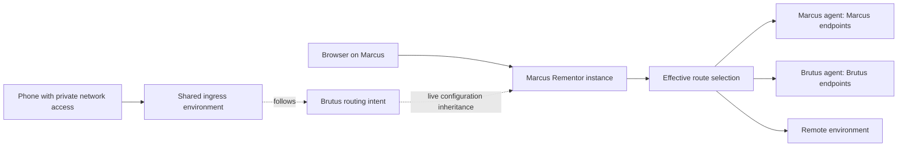

# Personal fleet routing and inherited environments

Status: the routing model and an executable inspection slice are implemented.
Live configuration synchronization, node forwarding, and shared ingress are
planned. This document supersedes the earlier single-host/same-origin proposal.

Baseline: local `main` at `1395f9f`, including the isolated routing sessions,
React/shadcn dashboard, and nginx reload improvements, combined with the GitHub
`origin/main` MCP protocol support at `a256291`. The local baseline had not been
pushed upstream when this work began; neither side should replace the other.

## Product contract

Rementor serves one person across their fleet of computers and client devices.
An instance can use its own environment or **follow another instance's routing
choices live**, then override individual routes. Phones and computers without
Rementor consume a reachable shared ingress; they need no nginx installation.

For example, Marcus inherits Brutus's environment. Brutus chooses its orders
process; Marcus follows that choice and runs billing on Marcus instead. When
Brutus switches orders to a remote environment, Marcus follows automatically.
When Brutus's selected process fails, the request fails visibly. Inheriting
Brutus's loopback endpoint never turns it into Marcus's loopback endpoint.

The domain supports independent public origins and paths for frontend, services,
login, and WebSockets. It does not require a frontend/API naming convention or
collapse all applications under one hostname. A frontend development build must
work across devices by referring to the configured public routing topology,
rather than baking in the machine hosting an upstream.

Tailscale support is required, but configuration inheritance and route selection
must also work without Tailscale. Tailscale Services is a candidate ingress
adapter, not a core dependency or a settled infrastructure choice. A custom
private transport can be another adapter if its access, identity, DNS, and TLS
behavior are verified.

Private transports connect stable gateway/agent endpoints. Switching an
application from Brutus to a remote environment changes Rementor's route
selection; it should not require editing network tunnel routes on every client.
Phone access still requires the chosen private network client or another
authenticated access path to that gateway.

These requirements come from the prior design thread
`941eee8e-8b24-469c-9a8f-588ffae0f0dc` and the continuation in
`80645e42-698e-4c50-b07f-402667ad5c02`. Named per-client profiles and transparent
shared-ingress device detection were recommendations in the old discussion;
they are not required by the clarified instance-inheritance model.

## Architecture



Separate configuration inheritance from request forwarding:

- Inheritance reads another instance's **routing intent**, not its rendered
  nginx config. Structured intent preserves endpoint ownership and route identity.
- Each instance owns its overrides. Nearest override wins, then its parent,
  then the route's baseline target. Removing an override resumes inheritance.
- A node-owned endpoint is forwarded through that node's authenticated agent.
  A URL containing `127.0.0.1` is dialed only in the owner's network namespace.
- Remote endpoints are reached directly under explicit upstream policy.
- A route alias follows another route's selection in the serving instance's
  effective environment. It does not cause an HTTP redirect or rematch the URL.
- Shared ingress follows a nominated environment. An ingress replica serving
  the same public access point must use the same effective environment; network
  load balancing must not select different development configurations at random.

This replaces a single replicated mutable routing table with independently
owned instance configuration. It does not require consensus to edit Marcus's or
Brutus's own overrides. Changing a **shared ingress environment selector** is
different: its owner must serialize/version changes so two gateways do not
silently disagree. A permanent fleet-wide coordinator is not needed for the
first inheritance slice.

## State and offline behavior

Existing routing sessions already persist a pinned remote baseline, local
registrations, revision metadata, and explicit preview/apply refresh. Preserve
that behavior. Fleet inheritance is a separate live relationship between
instances; it must not make feature sessions silently follow parent changes.
Extend the existing session/selector and transaction machinery where applicable
rather than adding a second incompatible workspace-cloning system. The chosen
inheritance scope must identify its environment/session explicitly.

See the [implemented session design](worktree-routing-sessions.md) and
[toggle latency work](toggle-latency.md). Fleet updates must preserve session
isolation, concurrency/version checks, routing proofs, and reload optimizations.

Use explicit, versioned records for nodes, origins, routes, targets, instance
overrides, inheritance pointers, and the shared ingress selector. Existing
workspace/environment identifiers and canonical application/service identities
remain durable references.

For live inheritance, each instance publishes a versioned snapshot of its own
intent, including the parent reference. Subscribers fetch and validate a
complete candidate, resolve the transitive inheritance graph, apply a detached
proxy projection, and publish only after successful persistence/application.
Reject missing references, environment-inheritance cycles, and effective
route-alias cycles. Polling a version endpoint is sufficient initially; streaming
can later reduce propagation latency without changing resolution semantics.

Proposed offline policy, still to validate in the live-sync milestone:

- Cache the last validated inherited snapshot. Report its source/version and
  stale status when its owner cannot be reached. Do not silently treat stale
  configuration as a current synchronization result.
- Local overrides remain editable without the parent. An inherited node target
  still fails if its endpoint/owner cannot be reached.
- A cached choice of a reachable remote endpoint may continue serving while the
  configuration owner is offline. Display the stale inheritance state separately
  from endpoint health. Failure of the configuration source and failure of the
  selected target are distinct events.
- Shared-selector changes require its current owner, or an explicit ownership
  transfer. Do not accept conflicting offline mutations to that selector.

Do not add silent failover between application instances. A user intentionally
testing Brutus must see Brutus's failure. A future explicit fallback policy must
report both the intended target and the actual target and remain opt-in.

## Public URLs and private access

The portable build consumes stable public routes; it never refers to an
upstream node's loopback URL. A build can use the current origin for genuinely
same-origin APIs, or an ingress-supplied runtime origin map for applications with
separate frontend/API/login/event origins. `window.location.origin` alone cannot
describe every topology.

Local `*.localhost` access continues to work with a local Rementor gateway that
inherits a reachable peer's intent. This does not require a Tailscale client when
the peer is accessible over another explicitly configured private transport.
Inheritance copies no DNS zone or certificate and cannot make an unreachable
peer endpoint reachable.

The same logical URL on multiple computers with different effective environments
needs an explicit **ingress-selection** design. Before promising that behavior
on portable HTTPS names, choose and test one of:

1. Local gateway interception of the canonical hostname, with supported DNS and
   trusted certificates on computers running Rementor. Phones use shared ingress.
2. Authenticated client-device selection at shared ingress, after proving exact
   node identity survives the chosen proxy path. The selected policy references
   that device's Rementor instance and its inherited environment.

Distinct instance entry URLs are useful for diagnostics, but changing bookmarks
and browser origins is not a substitute for the requested stable URL behavior.
Preserving exact origins offline also needs DNS/TLS handling. A local alias is
not evidence that the portable frontend build works offline unchanged. This
question belongs to the access/build milestone, rather than assuming that
configuration inheritance solves name resolution.

Tailscale can supply private node connectivity. Services adds stable service
names, TailVIPs, and Serve-managed HTTPS but has setup/tagging requirements and
does not supply arbitrary custom-domain wildcard hosting. Serve HTTP user headers
do not identify a specific device; Marcus and Brutus may share that user identity.
See the [verified research and provider acceptance tests](../research/tailscale-routing.md).

Keep the existing unauthenticated Connect control plane bound to loopback. Any
fleet synchronization or forwarding listener is a separate authenticated
interface. Enrollment must authorize peers independently of their ability to
reach a TCP port; every LAN/tunnel adapter must define how it establishes that
trust. A shared data-plane gateway must not accidentally expose management RPC.

## First runnable slice: implemented

`internal/routing` compiles an immutable, provider-independent intent snapshot
and resolves public URLs for a serving instance. The CLI reads an experimental
JSON file; it does not mutate the live workspace model or protobuf contract.

Implemented behavior:

- Explicit public origins, including scheme and port; exact and segment-bounded
  prefix path precedence, with HTTP(S)/WebSocket origin correspondence.
- Remote, node-owned, and logical-route target types.
- Transitive environment inheritance and per-instance route overrides.
- Shared ingress environment selection and inheritance provenance in output.
- Reference validation, duplicate-matcher rejection, and cycle rejection.
- Simulated endpoint/owner unavailability with a visible error and nonzero exit;
  no automatic fallback and no claim of live target health.
- Detached snapshots: changing caller-owned configuration cannot mutate an
  already compiled projection. Recompiling a parent change updates inherited
  selections while preserving child overrides.

Try the [fleet example](../../examples/fleet/README.md):

```bash
go run ./cmd/rementorctl --json topology resolve \
  --file examples/fleet/topology.json --instance marcus-dev \
  --url https://services.rementor.example.test/orders/42
```

The JSON schema is versioned as an **experiment**, not a replacement for existing
workspace export/import or generated RPC. URL paths are canonicalized; ambiguous
encoded paths are rejected in the inspector. Route rewriting, upstream header
policy, cookies/CORS, TLS, actual probes, replication, and listeners are outside
this slice. Do not use it as a production forwarding engine yet.

## Delivery milestones

| Milestone | Deliverable | Acceptance scenario |
| --- | --- | --- |
| 0 — intent resolution | Implemented file-based resolver, example, tests | Marcus follows Brutus's orders choice, keeps its billing override, and exposes target failure |
| 1 — durable fleet intent | SQLite records, protobuf/Connect contract, CLI/MCP/UI operations for inherit/select/reset | Restart preserves inheritance and overrides; invalid references/cycles fail before persistence; legacy workspace behavior is unchanged |
| 2 — live inheritance | Authenticated enrollment and versioned peer snapshot fetch/subscription; last-known snapshot and stale status | Brutus changes orders; Marcus follows automatically within a documented bound; a source outage is shown separately from endpoint failure |
| 3 — owner-aware forwarding | Authenticated node agent plus data-plane gateway, health observations and route proof | Marcus reaches Brutus's loopback endpoint; stop that endpoint and receive a clear 502/503 with target/node/version provenance; headers and WebSockets survive |
| 4 — portable ingress/build | Tailscale adapter and one non-Tailscale private transport; origin manifest, URL resolution, access selection | One frontend build works on both computers and a phone; the same URL respects selected instance environment; login/CORS/cookies work across the declared origins |
| 5 — shared access reliability | Explicit shared selector ownership and multiple equivalent ingress hosts where supported | Moving a gateway preserves public URL and effective environment; a gateway outage does not silently select a different app instance |

Next implementation should start with milestone 1, using this resolver's tested
semantics while extending the existing transaction/recovery path. Milestones 2
and 3 must define enrollment before adding any remotely accessible listener.
Milestone 4 begins with a provider proof of concept, not an assumption that
Serve headers or wildcard DNS will satisfy device-specific stable URLs.

Likely implementation surfaces:

- `internal/models`, `internal/config`: durable fleet intent and migrations.
- `proto/rementor/v1/rementor.proto`, generated clients: typed inheritance,
  effective-selection provenance, target ownership, and sync status.
- `internal/services`: candidate validation, operation/version handling,
  inherited-snapshot lifecycle, apply/rollback/recovery.
- `internal/routing`: deterministic effective route selection.
- A dedicated forwarding/enrollment package: authenticated data plane separated
  from local management RPC. Choose renderer versus request-time proxying based
  on the proved ingress-selection requirements.
- `internal/cli`, MCP, frontend: inherit/reset controls and intended versus
  effective target, owning node, inherited source/version, stale state, and health.
- Build-tool integrations: runtime public-origin manifest without machine-bound
  compile-time upstream addresses or committed changes to application repos.

Every milestone must preserve the existing `*.localhost` workflows and pass
`npm run verify`. Live device acceptance tests complement that gate; the local
container demo cannot verify actual Tailscale identity, phone TLS, or failover.
